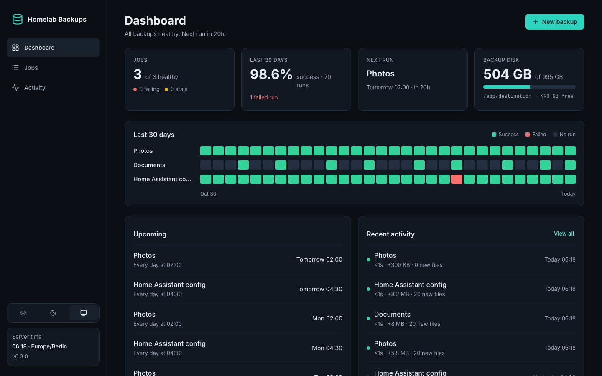
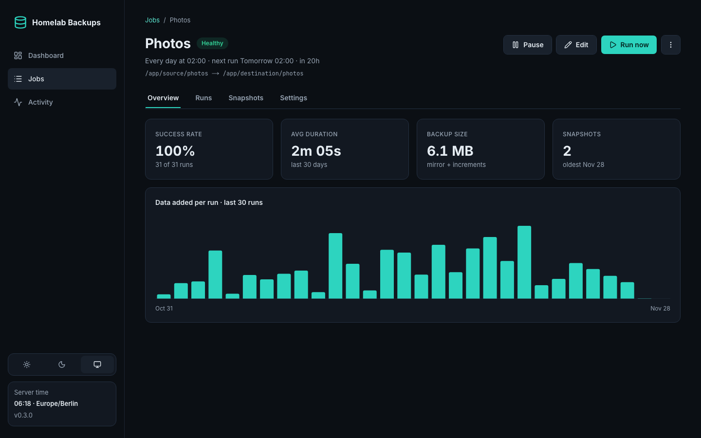
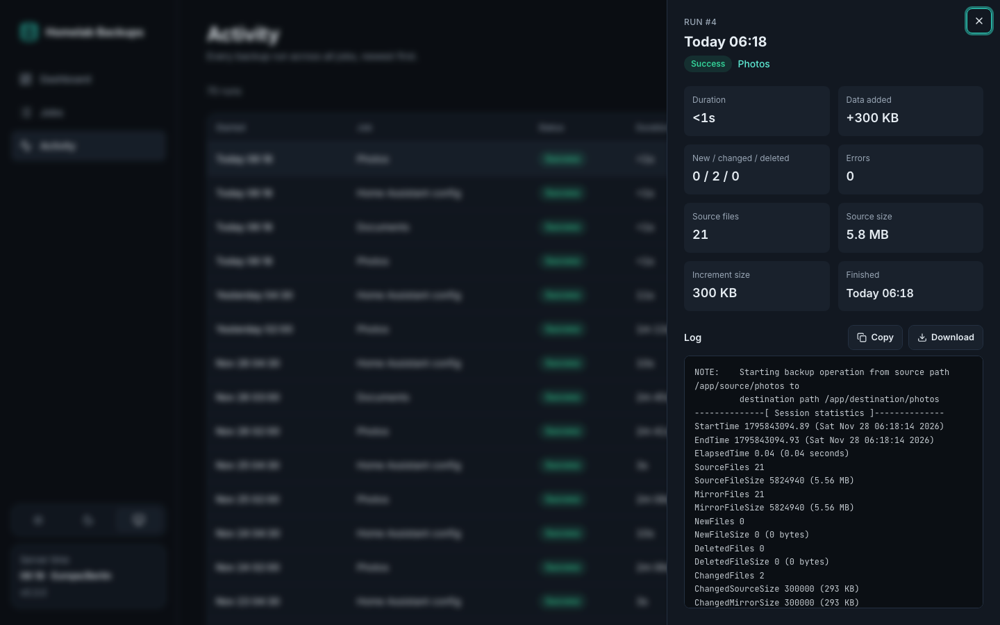
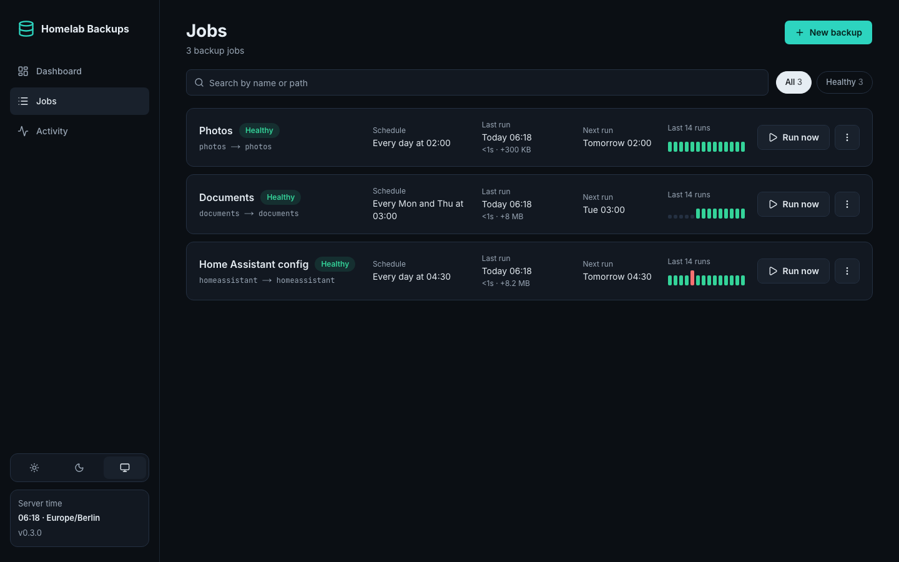
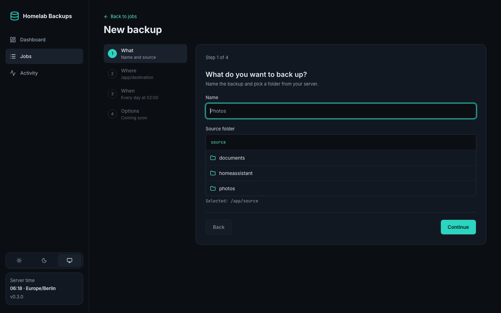

# Homelab Backups

Scheduled, versioned backups for your homelab, with a web UI that doesn't make you learn cron or rdiff-backup.

Pick a folder, pick where it goes, pick when. Homelab Backups runs [rdiff-backup](https://rdiff-backup.net/) on schedule, keeps every snapshot, and shows you what happened.



## Features

- **Schedules in plain words**: hourly, daily, weekly or monthly presets with a live summary ("Every Mon and Thu at 03:00") and the next run times. Raw cron is still there for power users.
- **Folder browser**: choose source and destination by clicking through your folders. Each job gets its own destination, so jobs never overwrite each other.
- **Dashboard**: health of every job, 30-day run calendar, upcoming runs and free space on the backup disk.
- **Full run history**: every run with duration, files new/changed/deleted, data added and errors, paginated and filterable. Open a run to read or download its log.
- **Snapshots**: every backup is an incremental rdiff-backup snapshot you can list per job.
- **Safe by default**: one run per job at a time, jobs stuck after a crash are reset, failed runs are flagged, and jobs can be paused instead of deleted.
- **Homelab friendly**: two small images for amd64 and arm64, `PUID`/`PGID`, health checks, dark and light themes, works on a phone.

| | |
|---|---|
|  |  |
|  |  |

## Quick start

1. Create a `docker-compose.yaml`:

    ```yaml
    services:
      backend:
        image: jonymaster/homelab-backups-backend:latest
        container_name: homelab-backups-backend
        volumes:
          - ${BACKUP_SOURCE}:/app/source:ro
          - ${BACKUP_DESTINATION}:/app/destination
          - ${APP_DB_PATH}:/app/data
        environment:
          - TZ=${TZ:-Etc/UTC}
          - PUID=${PUID:-1000}
          - PGID=${PGID:-1000}
        restart: unless-stopped

      frontend:
        image: jonymaster/homelab-backups-frontend:latest
        container_name: homelab-backups-frontend
        ports:
          - "3000:3000"
        depends_on:
          backend:
            condition: service_healthy
        restart: unless-stopped
    ```

2. Create a `.env` next to it:

    ```bash
    BACKUP_SOURCE=/srv/data              # what you want to back up (mounted read-only)
    BACKUP_DESTINATION=/mnt/usb/backups  # where backups go, ideally another disk
    APP_DB_PATH=/srv/homelab-backups     # app database
    TZ=Europe/Berlin                     # IANA name, used for schedules
    PUID=1000
    PGID=1000
    ```

3. Start it and open `http://<server>:3000`:

    ```bash
    docker compose up -d
    ```

Avoid mapping `/` as `BACKUP_SOURCE`; mount only what you want to back up.

## Configuration

| Variable | Default | Description |
|---|---|---|
| `BACKUP_SOURCE` | | Host folder to back up, mounted read-only at `/app/source`. |
| `BACKUP_DESTINATION` | | Host folder for backups, mounted at `/app/destination`. |
| `APP_DB_PATH` | | Host folder for the SQLite database. |
| `TZ` | `Etc/UTC` | Timezone for schedules and times, as an IANA name like `Asia/Tokyo`. Unknown names fall back to UTC. |
| `PUID` / `PGID` | `1000` | User the backups run as. `BACKUP_DESTINATION` must be writable by it. Use `0` to run as root, for example to back up files only root can read or to keep file ownership. |

Port 8686 (the API) is not published; the UI reaches it over the compose network.

## Upgrading

Back up the database folder, then pull and restart:

```bash
cp -r /srv/homelab-backups /srv/homelab-backups.bak
docker compose pull && docker compose up -d
```

Database migrations run automatically on startup. Release notes list anything else to change: see [Releases](https://github.com/jonymaster/homelab-backups/releases).

## Development

Backend (FastAPI, Python 3.12):

```bash
cd app && pip install -r requirements-dev.txt
mkdir -p data && uvicorn main:app --reload --port 8686
pytest
```

Frontend (Next.js, Node 20+):

```bash
cd frontend && npm install
npm run dev
npm run lint && npm test
```

Full stack from source:

```bash
cp docker/.env.example docker/.env   # then edit
cd docker && docker compose up -d --build
```

## Roadmap

- Retention and exclusions per job
- Restore files from a snapshot
- Notifications (ntfy, Gotify, Telegram, email)
- NFS destinations
- Remote destinations over SSH

Contributions and ideas are welcome: open an issue or a pull request.

## License

MIT, see [LICENSE](LICENSE).
